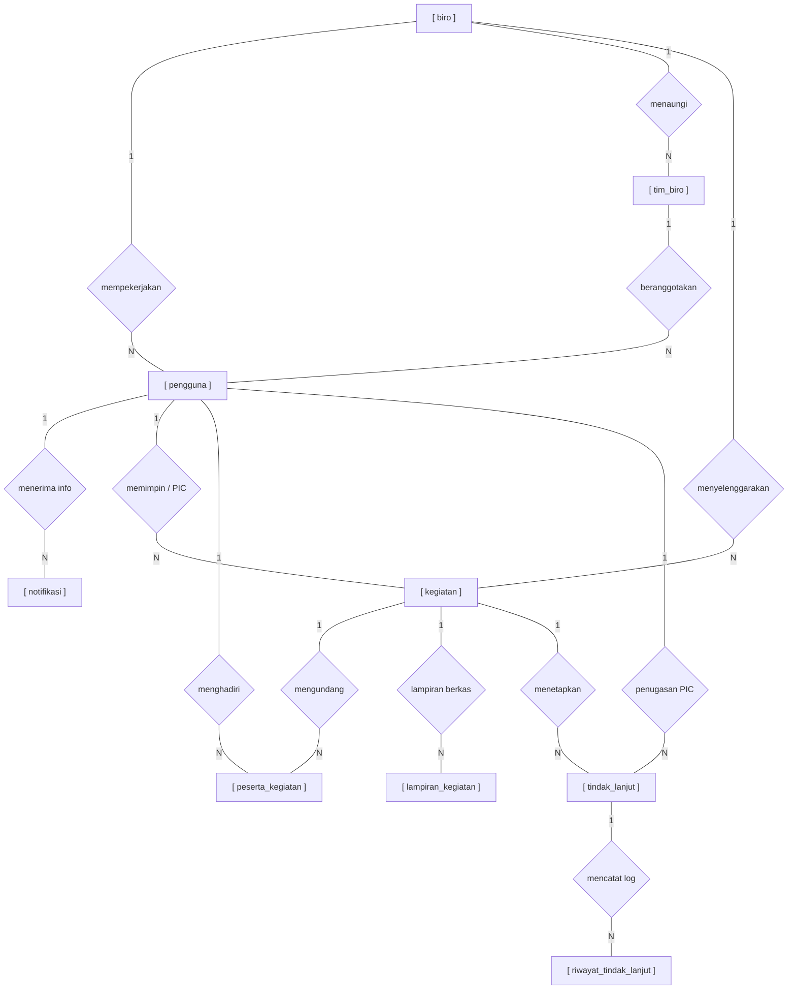
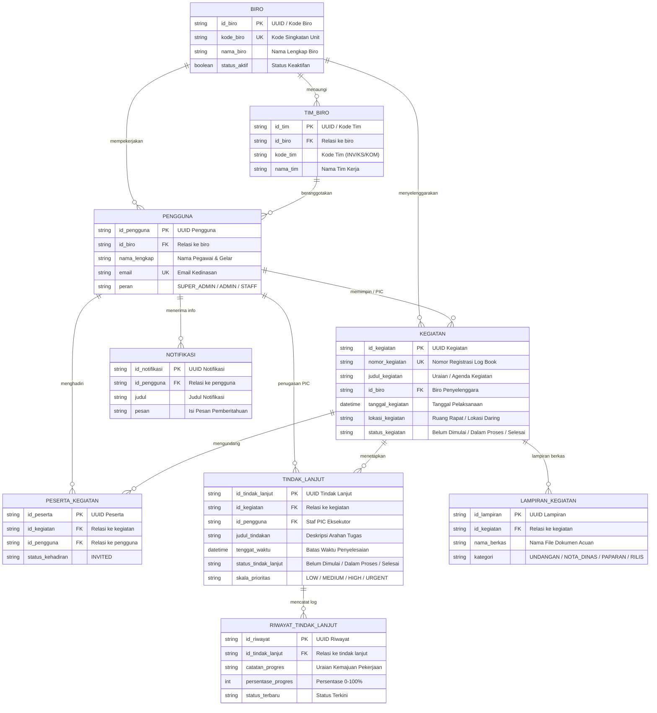

# PERANCANGAN BASIS DATA: ERD (SUB-BAB 3.2.4.a)
## Aplikasi Jadwal dan Pengarsipan Kegiatan pada Sekretariat Jenderal Dewan Nasional Kawasan Ekonomi Khusus
**Program Studi Informatika — Fakultas Teknik & Informatika Universitas Bina Sarana Informatika (UBSI) 2026**

Dokumen ini memuat perancangan resmi **Entity Relationship Diagram (ERD)** menggunakan **Notasi Peter Chen** murni sesuai dengan **Buku Pedoman PKL UBSI Tahun 2026 (Outline 3 - Perancangan dan Pembuatan Program)**.

> [!IMPORTANT]
> **Kebijakan Basis Data Riil & Penamaan Domain Kegiatan:**  
> Sistem yang dirancang dan dibangun adalah **Log Book Kegiatan (Aplikasi Jadwal & Pengarsipan Kegiatan KEK)**. Berdasarkan hasil audit data aktual pada basis data cloud **Neon PostgreSQL**, perancangan ERD ini **hanya memodelkan entitas yang benar-benar aktif dan memiliki record data riil**. Tabel-tabel yang berstatus kosong (0 rows / tidak digunakan oleh sistem seperti `meeting_minutes`, `minutes_comments`, `minutes_histories`, `biro_meeting_sequences`, dan `meeting_biros`) **dieliminasi dan tidak dimasukkan ke dalam ERD**.

---

## 1. Audit Data Aktual Basis Data Neon PostgreSQL

Hasil inspeksi langsung terhadap tabel pada basis data produksi:

| No | Model Prisma / Nama Tabel | Status Baris Data | Keputusan Pemodelan ERD | Keterangan Fungsional |
|:---:|:---|:---:|:---:|:---|
| 1 | **`biro`** (`Biro`) | **5 baris** | **Dimodelkan (Aktif)** | Master data biro kerja Setjen DN KEK. |
| 2 | **`tim_biro`** (`BiroTeam`) | **5 baris** | **Dimodelkan (Aktif)** | Unit kerja teknis (Tim Investasi, Kerja Sama, Komunikasi). |
| 3 | **`pengguna`** (`User`) | **23 baris** | **Dimodelkan (Aktif)** | Data akun aparatur kedinasan dan hak akses peran. |
| 4 | **`kegiatan`** (`Meeting`) | **23 baris** | **Dimodelkan (Aktif)** | Entitas sentral jadwal log book kegiatan, nomor registrasi, dan catatan hasil. |
| 5 | **`peserta_kegiatan`** (`MeetingParticipant`) | **38 baris** | **Dimodelkan (Aktif)** | Daftar pihak terkait / undangan kedinasan sebagai rujukan dokumen. |
| 6 | **`lampiran_kegiatan`** (`MeetingAttachment`) | **9 baris** | **Dimodelkan (Aktif)** | Berkas digital naskah acuan (undangan, nota dinas, paparan, rilis). |
| 7 | **`tindak_lanjut`** (`ActionItem`) | **36 baris** | **Dimodelkan (Aktif)** | Butir komitmen tugas tindak lanjut dan tenggat waktu. |
| 8 | **`riwayat_tindak_lanjut`** (`ActionItemLog`) | **34 baris** | **Dimodelkan (Aktif)** | Catatan log progres persentase dan pembaruan tugas tindak lanjut. |
| 9 | **`notifikasi`** (`Notification`) | **35 baris** | **Dimodelkan (Aktif)** | Pesan pemberitahuan jadwal kegiatan dan tugas aparatur. |
| 10 | `notulen_kegiatan` (`MeetingMinutes`) | **0 baris** | *Dieliminasi (Kosong)* | Ringkasan hasil disimpan langsung pada atribut entitas `kegiatan`. |
| 11 | `komentar_notulen` (`MinutesComment`) | **0 baris** | *Dieliminasi (Kosong)* | Tidak ada record data aktif di database. |
| 12 | `riwayat_notulen` (`MinutesHistory`) | **0 baris** | *Dieliminasi (Kosong)* | Tidak ada record data aktif di database. |
| 13 | `penomoran_kegiatan_biro` (`BiroMeetingSequence`) | **0 baris** | *Dieliminasi (Kosong)* | Penomoran di-generate secara algoritmik di kode program. |
| 14 | `kegiatan_biro` (`MeetingBiro`) | **0 baris** | *Dieliminasi (Kosong)* | Relasi biro pemrakarsa langsung dicatat via foreign key `id_biro`. |

---

## 2. Berkas Diagram Resmi & Render Gambar

* **File Diagram Draw.io Multi-Tab:** [`docs/ERD_Log_Book_Rapat.drawio`](file:///C:/Users/PC/Website-Log-Rapat-Kek/docs/ERD_Log_Book_Rapat.drawio)
* **File Gambar Resolusi Tinggi (PNG):** [`docs/erd_diagram_standar.png`](file:///C:/Users/PC/Website-Log-Rapat-Kek/docs/erd_diagram_standar.png)
* **Mirror Publik PNG:** [`public/erd_diagram_standar.png`](file:///C:/Users/PC/Website-Log-Rapat-Kek/public/erd_diagram_standar.png)
* **Source Render SVG/HTML:** [`public/erd_render.html`](file:///C:/Users/PC/Website-Log-Rapat-Kek/public/erd_render.html)

---

## 3. Visualisasi Mermaid ERD Notasi Peter Chen (9 Entitas Aktif - Log Book Kegiatan)

---

## 4. Visualisasi Skema Relasional (Crow's Foot Entity Diagram)

---

## 5. Kamus Data & Atribut Entitas Aktif

### 1. Entitas `biro` (Master Unit Kerja Biro)
* **`id_biro`** `VARCHAR(50)` **[PK]** : Kunci utama unik biro (contoh: `BIRO-IKK`).
* **`kode_biro`** `VARCHAR(20)` **[UK]** : Kode unik biro (`IKK`, `BPPK`, `PKKEK`, `HSDMO`, `UK`).
* **`nama_biro`** `VARCHAR(255)` : Nama lengkap biro di lingkungan Setjen KEK.
* **`status_aktif`** `BOOLEAN` : Status aktif/tidaknya unit kerja.

### 2. Entitas `tim_biro` (Tim Kerja di Bawah Biro)
* **`id_tim`** `VARCHAR(50)` **[PK]** : Kunci utama tim kerja (contoh: `TIM-001`).
* **`id_biro`** `VARCHAR(50)` **[FK]** : Mengacu ke `biro(id_biro)`.
* **`kode_tim`** `VARCHAR(20)` : Kode singkatan tim (`INV`, `KS`, `KOM`).
* **`nama_tim`** `VARCHAR(150)` : Nama resmi tim kerja operasional.

### 3. Entitas `pengguna` (Akun Staf & Pimpinan Aparatur)
* **`id_pengguna`** `VARCHAR(50)` **[PK]** : Kunci utama unik akun pengguna.
* **`id_biro`** `VARCHAR(50)` **[FK]** : Mengacu ke `biro(id_biro)`.
* **`nama_lengkap`** `VARCHAR(255)` : Nama pegawai beserta gelar resmi.
* **`email`** `VARCHAR(255)` **[UK]** : Alamat email dinas untuk autentikasi.
* **`peran`** `VARCHAR(30)` : Hak akses peran sistem (`SUPER_ADMIN`, `ADMIN`, `STAFF`).

### 4. Entitas `kegiatan` (Agenda Log Book Kegiatan Dinas & Catatan Hasil)
* **`id_kegiatan`** `VARCHAR(50)` **[PK]** : Kunci utama unik log book kegiatan.
* **`nomor_kegiatan`** `VARCHAR(100)` **[UK]** : Nomor urut registrasi dinas otomatis (`REG-2026-X-001`).
* **`judul_kegiatan`** `VARCHAR(255)` : Topik atau agenda kegiatan dinas.
* **`tanggal_kegiatan`** `DATE` : Tanggal pelaksanaan kegiatan dinas.
* **`lokasi_kegiatan`** `VARCHAR(255)` : Ruang rapat fisik atau tautan pertemuan daring.
* **`status_kegiatan`** `VARCHAR(50)` : Status 3 tahapan (`Belum Dimulai`, `Dalam Proses`, `Selesai`).

### 5. Entitas `peserta_kegiatan` (Daftar Pihak Terkait / Undangan)
* **`id_peserta`** `VARCHAR(50)` **[PK]** : Kunci utama record pihak terkait.
* **`id_kegiatan`** `VARCHAR(50)` **[FK]** : Mengacu ke `kegiatan(id_kegiatan)`.
* **`id_pengguna`** `VARCHAR(50)` **[FK]** : Mengacu ke `pengguna(id_pengguna)`.
* **`status_kehadiran`** `VARCHAR(30)` : Status keterlibatan pihak terkait.

### 6. Entitas `lampiran_kegiatan` (Berkas Dokumen Acuan Digital)
* **`id_lampiran`** `VARCHAR(50)` **[PK]** : Kunci utama lampiran berkas naskah dinas.
* **`id_kegiatan`** `VARCHAR(50)` **[FK]** : Mengacu ke `kegiatan(id_kegiatan)`.
* **`nama_berkas`** `VARCHAR(255)` : Nama asli berkas dokumen dinas.
* **`kategori`** `VARCHAR(50)` : Kategori berkas (`UNDANGAN`, `NOTA_DINAS`, `PAPARAN`, `RILIS`).

### 7. Entitas `tindak_lanjut` (Butir Tindak Lanjut Komitmen)
* **`id_tindak_lanjut`** `VARCHAR(50)` **[PK]** : Kunci utama unik butir tindak lanjut kegiatan.
* **`id_kegiatan`** `VARCHAR(50)` **[FK]** : Mengacu ke `kegiatan(id_kegiatan)`.
* **`id_pengguna`** `VARCHAR(50)` **[FK, Nullable]** : Staf PIC eksekutor tugas.
* **`judul_tindakan`** `VARCHAR(255)` : Uraian ringkas arahan tugas tindak lanjut.
* **`tenggat_waktu`** `DATE` : Batas akhir waktu penyelesaian tugas (*deadline*).
* **`status_tindak_lanjut`** `VARCHAR(50)` : Status 3 tahapan (`Belum Dimulai`, `Dalam Proses`, `Selesai`).
* **`skala_prioritas`** `VARCHAR(30)` : Tingkat urgensi (`LOW`, `MEDIUM`, `HIGH`, `URGENT`).

### 8. Entitas `riwayat_tindak_lanjut` (Catatan Log Progres Tindak Lanjut)
* **`id_riwayat`** `VARCHAR(50)` **[PK]** : Kunci utama riwayat catatan log tugas.
* **`id_tindak_lanjut`** `VARCHAR(50)` **[FK]** : Mengacu ke `tindak_lanjut(id_tindak_lanjut)`.
* **`catatan_progres`** `TEXT` : Uraian kemajuan pekerjaan atau kendala di lapangan.
* **`persentase_progres`** `INT` : Persentase penyelesaian fisik (0 - 100%).
* **`status_terbaru`** `VARCHAR(50)` : Status tahapan terkini (`Belum Dimulai`, `Dalam Proses`, `Selesai`).

### 9. Entitas `notifikasi` (Pemberitahuan Sistem ke Akun Aparatur)
* **`id_notifikasi`** `VARCHAR(50)` **[PK]** : Kunci utama unik notifikasi.
* **`id_pengguna`** `VARCHAR(50)` **[FK]** : Mengacu ke `pengguna(id_pengguna)`.
* **`judul`** `VARCHAR(255)` : Judul notifikasi agenda/tugas kegiatan.
* **`pesan`** `TEXT` : Isi pesan pemberitahuan kegiatan atau tugas baru.
