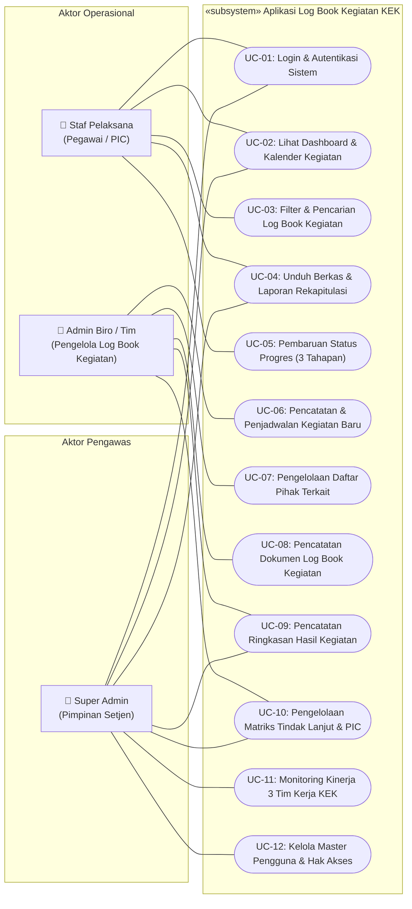

# PERANCANGAN UML USE CASE DIAGRAM (SUB-BAB 3.2.2.a)
## Aplikasi Log Book Kegiatan pada Sekretariat Jenderal Dewan Nasional Kawasan Ekonomi Khusus
**Program Studi Informatika — Fakultas Teknik & Informatika Universitas Bina Sarana Informatika (UBSI) 2026**

Dokumen ini memuat perancangan resmi **UML Use Case Diagram** dan **Skenario Use Case (Use Case Specification)** untuk Aplikasi Log Book Kegiatan KEK, mencakup identifikasi Aktor, Batasan Sistem (*System Boundary*), Relasi Asosiasi, serta deskripsi skenario aksi-reaksi (*Normal & Alternative Flow*) sesuai standar **Buku Pedoman PKL UBSI Tahun 2026 (Outline 3 - Perancangan dan Pembuatan Program)**.

> [!NOTE]
> **Penempatan pada Laporan PKL (Pedoman PKL UBSI Tahun 2026 Sub-Bab 3.2.2.a):**  
> Ditempatkan pada **BAB III PEMBAHASAN &rarr; 3.2. Pembuatan Program &rarr; 3.2.2. Design Program &rarr; a. Use Case Diagram**.  
> **Ketentuan Khusus:**  
> 1. Sistem **tidak memiliki presensi/absensi fisik peserta kegiatan**. Peserta dikelola sebagai *Daftar Pihak Terkait/Undangan Kegiatan* untuk keperluan log book kegiatan.
> 2. Status kegiatan dan tindak lanjut strictly 3 tahapan resmi: `Belum Dimulai`, `Dalam Proses`, dan `Selesai`.

---

## 1. Berkas Diagram Draw.io & Gambar Resmi

- **Draw.io Multi-Tab:** [`docs/USE_CASE_Log_Book_Rapat.drawio`](file:///C:/Users/PC/Website-Log-Rapat-Kek/docs/USE_CASE_Log_Book_Rapat.drawio)
- **Gambar Render Resolusi Tinggi (PNG):** [`public/use_case_diagram_standar.png`](file:///C:/Users/PC/Website-Log-Rapat-Kek/public/use_case_diagram_standar.png)
- **Pratinjau HTML Interaktif:** [`public/use_case_render.html`](file:///C:/Users/PC/Website-Log-Rapat-Kek/public/use_case_render.html)

---

## 2. Identifikasi & Karakteristik Aktor Sistem

Sistem membedakan pengguna ke dalam 3 tingkatan peran (*role*) berbasis prinsip **Role-Based Access Control (RBAC)** dan hierarki kewenangan di lingkungan Setjen DN KEK:

| No | Nama Aktor | Posisi Diagram | Deskripsi Peran & Tanggung Jawab | Hak Akses Utama |
|:---|:-----------|:---------------|:--------------------------------|:----------------|
| 1  | **Staf Pelaksana** *(Pegawai / PIC)* | Kiri Atas | Pegawai operasional internal yang ditugaskan sebagai *Person in Charge* (PIC) kegiatan atau pelaksana butir arahan tindak lanjut. | • Login & autentikasi sistem. • Melihat dashboard dan kalender agenda kegiatan. • Melakukan filter lanjutan & pencarian log book kegiatan. • Mengunduh berkas materi, undangan, dan laporan. • Memperbarui status progres kegiatan (3 tahapan). |
| 2  | **Admin Biro / Tim** *(Pengelola Log Book Kegiatan)* | Kiri Bawah | Pengelola administrasi persuratan dan pencatatan log book pada masing-masing biro/tim kerja KEK (Investasi, Kerja Sama, Komunikasi). Mewarisi seluruh hak akses Staf Pelaksana. | • Mencatat dan menjadwalkan agenda kegiatan baru. • Mengelola daftar pihak terkait / undangan kegiatan. • Mengunggah berkas dokumen kegiatan lengkap (undangan, nota konsumsi, materi, rilis). • Mencatat ringkasan catatan hasil kegiatan. • Mengelola matriks tindak lanjut (*action items*), penunjukan PIC, dan tenggat waktu. |
| 3  | **Super Admin** *(Pimpinan Setjen)* | Kanan Tengah | Pimpinan unit dan administrator sistem utama di lingkungan Sekretariat Jenderal Dewan Nasional KEK yang mengawasi seluruh proses kerja lintas unit. Mewarisi seluruh hak akses operasional. | • Memantau dashboard monitoring eksekutif lintas 3 tim kerja KEK. • Meninjau seluruh agenda dan validasi data log book kegiatan. • Mengelola data master pengguna dan penetapan peran (*roles*). • Mengunduh rekapitulasi eksekutif (PDF resmi & Excel). |

---

## 3. Visualisasi Mermaid Use Case Diagram (Format Standar)

---

## 4. Tabel Skenario Deskripsi Use Case (Use Case Specifications)

Berikut adalah tabel deskripsi skenario use case standar berdasarkan kaidah rekayasa perangkat lunak pada Pedoman PKL UBSI:

### 1. Tabel Skenario UC-01: Login & Autentikasi Sistem
| Elemen | Keterangan |
|:---|:---|
| **Nomor Use Case** | UC-01 |
| **Nama Use Case** | Login & Autentikasi Sistem |
| **Aktor** | Staf Pelaksana, Admin Biro / Tim, Super Admin |
| **Deskripsi** | Pengguna memasukkan kredensial berupa email resmi dan kata sandi untuk mengakses hak fitur aplikasi. |
| **Kondisi Awal (*Pre-condition*)** | Pengguna telah memiliki akun terdaftar dan berada pada halaman Login sistem. |
| **Skenario Normal (*Main Flow*)** | 1. Pengguna membuka peramban web dan mengakses halaman login. 2. Pengguna memasukkan alamat email resmi dan kata sandi valid. 3. Pengguna menekan tombol "Masuk ke Sistem". 4. Sistem memverifikasi kredensial melalui algoritma hash Argon2id. 5. Sistem membuat sesi terenkripsi (JWT/Session Cookie) dan mengarahkan pengguna ke halaman Dashboard. |
| **Skenario Alternatif (*Exception*)** | 2a. Pengguna memasukkan email atau kata sandi yang salah. 3a. Sistem menampilkan pesan peringatan error "Email atau kata sandi tidak valid". Pengguna tetap pada form login. |
| **Kondisi Akhir (*Post-condition*)** | Sesi pengguna aktif dan menu antarmuka disesuaikan dengan peran (*role*) masing-masing. |

---

### 2. Tabel Skenario UC-02: Lihat Dashboard & Kalender Agenda Kegiatan
| Elemen | Keterangan |
|:---|:---|
| **Nomor Use Case** | UC-02 |
| **Nama Use Case** | Lihat Dashboard & Kalender Agenda Kegiatan |
| **Aktor** | Staf Pelaksana, Admin Biro / Tim, Super Admin |
| **Deskripsi** | Menampilkan ringkasan statistik kegiatan, matriks tindak lanjut, dan visualisasi kalender kegiatan terpadu. |
| **Kondisi Awal (*Pre-condition*)** | Pengguna telah berhasil login ke dalam sistem. |
| **Skenario Normal (*Main Flow*)** | 1. Pengguna memilih menu "Dashboard" atau "Kalender". 2. Sistem mengambil data kegiatan aktif dari basis data. 3. Sistem menyajikan kartu metrik rekapitulasi dan tampilan grid kalender kegiatan (bulanan/mingguan). 4. Pengguna dapat mengklik salah satu agenda pada kalender untuk melihat pratinjau ringkas. |
| **Skenario Alternatif (*Exception*)** | 2a. Terjadi gangguan koneksi jaringan ke basis data. 3a. Sistem menampilkan indikator pemuatan dan pesan informasi "Gagal memuat kalender kegiatan, silakan muat ulang". |
| **Kondisi Akhir (*Post-condition*)** | Pengguna memperoleh informasi jadwal agenda kegiatan secara terstruktur dan mutakhir. |

---

### 3. Tabel Skenario UC-03: Filter & Pencarian Log Book Kegiatan
| Elemen | Keterangan |
|:---|:---|
| **Nomor Use Case** | UC-03 |
| **Nama Use Case** | Filter & Pencarian Log Book Kegiatan |
| **Aktor** | Staf Pelaksana, Admin Biro / Tim, Super Admin |
| **Deskripsi** | Menyaring dan mencari data riwayat kegiatan berdasarkan judul, kategori naskah, atau rentang waktu. |
| **Kondisi Awal (*Pre-condition*)** | Pengguna berada pada halaman Log Book Kegiatan. |
| **Skenario Normal (*Main Flow*)** | 1. Pengguna mengetik kata kunci pada kolom pencarian atau memilih filter kategori (Naskah Masuk, Disposisi Sekjen, Disposisi Karo, Kegiatan Internal, Laporan Rutin). 2. Sistem secara reaktif menyaring daftar tabel kegiatan yang relevan. 3. Pengguna meninjau daftar kegiatan yang sesuai. |
| **Skenario Alternatif (*Exception*)** | 2a. Kata kunci pencarian tidak ditemukan dalam basis data. 3a. Sistem menampilkan pesan informatif "Tidak ada kegiatan yang sesuai dengan filter pencarian". |
| **Kondisi Akhir (*Post-condition*)** | Tabel menampilkan data log book kegiatan yang sesuai kriteria pencarian pengguna. |

---

### 4. Tabel Skenario UC-04: Unduh Berkas & Laporan Rekapitulasi
| Elemen | Keterangan |
|:---|:---|
| **Nomor Use Case** | UC-04 |
| **Nama Use Case** | Unduh Berkas & Laporan Rekapitulasi |
| **Aktor** | Staf Pelaksana, Admin Biro / Tim, Super Admin |
| **Deskripsi** | Mengunduh lampiran dokumen kegiatan dan mengekspor rekapitulasi laporan ke format PDF resmi atau file Excel/Word. |
| **Kondisi Awal (*Pre-condition*)** | Pengguna berada pada halaman rincian kegiatan atau halaman log book kegiatan. |
| **Skenario Normal (*Main Flow*)** | 1. Pengguna menekan tombol "Unduh Lampiran" pada berkas atau tombol "Ekspor PDF Laporan". 2. Sistem memvalidasi hak otorisasi unduh dokumen. 3. Sistem mengompilasi layout dokumen ber-kop surat Setjen DN KEK resmi. 4. Berkas terunduh secara otomatis ke perangkat penyimpanan lokal pengguna. |
| **Skenario Alternatif (*Exception*)** | 2a. Berkas lampiran fisik tidak ditemukan pada server penyimpanan. 3a. Sistem menampilkan peringatan "Dokumen lampiran belum tersedia atau tautan tidak valid". |
| **Kondisi Akhir (*Post-condition*)** | Dokumen rekapitulasi atau lampiran dokumen log book tersimpan pada perangkat pengguna. |

---

### 5. Tabel Skenario UC-05: Pembaruan Status Progres (3 Tahapan)
| Elemen | Keterangan |
|:---|:---|
| **Nomor Use Case** | UC-05 |
| **Nama Use Case** | Pembaruan Status Progres Kegiatan (3 Tahapan) |
| **Aktor** | Staf Pelaksana (PIC), Admin Biro / Tim |
| **Deskripsi** | Mengubah status pelaksanaan agenda atau butir tindak lanjut pada 3 tahapan resmi: `Belum Dimulai`, `Dalam Proses`, atau `Selesai`. |
| **Kondisi Awal (*Pre-condition*)** | Pengguna membuka halaman rincian kegiatan aktif. |
| **Skenario Normal (*Main Flow*)** | 1. Pengguna mengklik lencana status (*badge*) pada header rincian kegiatan. 2. Muncul *quick popover menu* yang menyajikan 3 pilihan status resmi. 3. Pengguna memilih status baru (misal: "Dalam Proses" &rarr; "Selesai"). 4. Sistem memperbarui atribut status di basis data dan menampilkan notifikasi sukses. |
| **Skenario Alternatif (*Exception*)** | 3a. Pengguna staf tanpa hak sunting mencoba mengubah kegiatan milik biro/tim lain. 4a. Sistem menonaktifkan kontrol popover dan menampilkan mode pratinjau (*read-only*). |
| **Kondisi Akhir (*Post-condition*)** | Status kegiatan terbarui secara real-time pada basis data, dashboard, dan kalender kegiatan. |

---

### 6. Tabel Skenario UC-06: Pencatatan & Penjadwalan Kegiatan Baru
| Elemen | Keterangan |
|:---|:---|
| **Nomor Use Case** | UC-06 |
| **Nama Use Case** | Pencatatan & Penjadwalan Kegiatan Baru |
| **Aktor** | Admin Biro / Tim, Super Admin |
| **Deskripsi** | Mendaftarkan jadwal agenda kegiatan baru ke dalam sistem. |
| **Kondisi Awal (*Pre-condition*)** | Pengguna mengakses formulir "Catat Kegiatan Baru". |
| **Skenario Normal (*Main Flow*)** | 1. Pengguna mengisi judul agenda, klasifikasi kategori naskah, waktu mulai, lokasi fisik / tautan virtual Zoom, tim kerja pemrakarsa, dan staf PIC. 2. Pengguna menekan tombol "Simpan Jadwal Kegiatan". 3. Sistem memvalidasi seluruh kolom isian wajib dan menerbitkan nomor registrasi kegiatan unik. 4. Sistem menetapkan status awal menjadi "Belum Dimulai" dan menyinkronkannya ke kalender kegiatan. |
| **Skenario Alternatif (*Exception*)** | 2a. Pengguna mengosongkan kolom isian wajib (misal: judul agenda kosong). 3a. Sistem menandai kolom dengan batas merah dan memunculkan pesan validasi "Kolom ini wajib diisi". |
| **Kondisi Akhir (*Post-condition*)** | Agenda kegiatan baru berhasil tersimpan dan terpublikasi di kalender kegiatan. |

---

### 7. Tabel Skenario UC-07: Pengelolaan Daftar Pihak Terkait
| Elemen | Keterangan |
|:---|:---|
| **Nomor Use Case** | UC-07 |
| **Nama Use Case** | Pengelolaan Daftar Pihak Terkait / Undangan Kegiatan |
| **Aktor** | Admin Biro / Tim, Super Admin |
| **Deskripsi** | Menata daftar pejabat, aparatur internal, maupun narasumber/tamu eksternal kementerian yang diundang pada agenda kegiatan sebagai dokumen acuan log book. |
| **Kondisi Awal (*Pre-condition*)** | Pengguna berada pada tab "Pihak Terkait" di formulir atau rincian kegiatan. |
| **Skenario Normal (*Main Flow*)** | 1. Pengguna memilih aparatur internal dari daftar pengguna atau mengetik nama dan instansi pejabat eksternal. 2. Pengguna menekan tombol "Tambah Pihak Terkait". 3. Sistem memvalidasi data dan mengaitkan profil pihak terkait ke agenda kegiatan. 4. Tabel daftar undangan terbarui secara teratur. |
| **Skenario Alternatif (*Exception*)** | 2a. Nama pihak eksternal kosong saat tombol tambah ditekan. 3a. Sistem menampilkan pesan "Nama pihak atau pejabat terkait wajib diisi". |
| **Kondisi Akhir (*Post-condition*)** | Daftar pihak dan instansi terkait tercatat rapi sebagai rujukan keperluan log book kegiatan (tanpa absensi kehadiran fisik). |

---

### 8. Tabel Skenario UC-08: Pencatatan Dokumen Log Book Kegiatan
| Elemen | Keterangan |
|:---|:---|
| **Nomor Use Case** | UC-08 |
| **Nama Use Case** | Pencatatan Dokumen Log Book Kegiatan |
| **Aktor** | Admin Biro / Tim, Super Admin |
| **Deskripsi** | Mengunggah dan menata berkas-berkas digital acuan kegiatan (surat undangan, nota konsumsi konsumsi, bahan tayang materi, tautan cloud drive, dan rilis publikasi). |
| **Kondisi Awal (*Pre-condition*)** | Pengguna berada pada modul pencatatan dokumen log book kegiatan. |
| **Skenario Normal (*Main Flow*)** | 1. Pengguna memilih tipe berkas dokumen yang akan diunggah. 2. Pengguna memilih file dari komputer lokal (format PDF, DOCX, PPTX, maksimal 10MB) atau memasukkan URL rilis berita. 3. Pengguna menekan tombol "Unggah Berkas". 4. Sistem memeriksa format MIME type dan integritas ukuran berkas. 5. Sistem menyimpan berkas ke repositori terstruktur dan menautkannya ke ID kegiatan. |
| **Skenario Alternatif (*Exception*)** | 3a. Berkas melebihi kapasitas 10MB atau berekstensi terlarang (.exe). 4a. Sistem menolak unggahan dan menampilkan notifikasi "Ukuran berkas melebihi batas 10MB atau format tidak didukung". |
| **Kondisi Akhir (*Post-condition*)** | Berkas digital tersimpan secara terpusat dan siap diakses atau diunduh oleh aparatur yang berwenang. |

---

### 9. Tabel Skenario UC-09: Pencatatan Ringkasan Hasil Kegiatan
| Elemen | Keterangan |
|:---|:---|
| **Nomor Use Case** | UC-09 |
| **Nama Use Case** | Pencatatan Ringkasan Catatan Hasil Kegiatan |
| **Aktor** | Admin Biro / Tim, Super Admin |
| **Deskripsi** | Mendokumentasikan rangkuman pokok pembahasan, arahan pimpinan, dan kesimpulan hasil kegiatan. |
| **Kondisi Awal (*Pre-condition*)** | Pengguna membuka tab "Catatan Hasil Kegiatan" pada detail agenda. |
| **Skenario Normal (*Main Flow*)** | 1. Pengguna menginput intisari pembahasan dan kesimpulan pada editor catatan hasil. 2. Pengguna menekan tombol "Simpan Catatan Hasil". 3. Sistem memvalidasi input teks dan menyimpan catatan terhubung langsung dengan ID kegiatan. 4. Sistem menyajikan pratinjau catatan hasil yang terformat rapi. |
| **Skenario Alternatif (*Exception*)** | 2a. Pengguna mencoba mengosongkan seluruh isi catatan saat proses simpan. 3a. Sistem menampilkan dialog konfirmasi pengosongan catatan. |
| **Kondisi Akhir (*Post-condition*)** | Catatan ringkas hasil kegiatan tersimpan permanen sebagai dokumen resmi Setjen KEK. |

---

### 10. Tabel Skenario UC-10: Pengelolaan Matriks Tindak Lanjut & PIC
| Elemen | Keterangan |
|:---|:---|
| **Nomor Use Case** | UC-10 |
| **Nama Use Case** | Pengelolaan Matriks Tindak Lanjut (*Action Items*) & PIC |
| **Aktor** | Admin Biro / Tim, Super Admin |
| **Deskripsi** | Merumuskan butir penugasan tindak lanjut hasil kegiatan, menunjuk tim kerja pelaksana, menetapkan tenggat waktu, dan memantau agregasi 4 kartu KPI (*Total, Belum Dimulai, Dalam Proses, Selesai*). |
| **Kondisi Awal (*Pre-condition*)** | Pengguna membuka modul "Matriks Tindak Lanjut". |
| **Skenario Normal (*Main Flow*)** | 1. Pengguna menekan tombol "Tambah Tindak Lanjut". 2. Pengguna menginput deskripsi arahan, memilih tim penanggung jawab (Investasi, Kerja Sama, Komunikasi, dll.), staf PIC, dan tanggal tenggat waktu (*deadline*). 3. Pengguna menekan tombol "Simpan Tindak Lanjut". 4. Sistem mencatat butir tugas ke basis data dan memperbarui statistik kartu KPI secara otomatis. |
| **Skenario Alternatif (*Exception*)** | 2a. Deskripsi tugas atau tenggat waktu dikosongkan. 3a. Sistem menampilkan peringatan "Deskripsi arahan tugas dan tanggal tenggat waktu wajib diisi". |
| **Kondisi Akhir (*Post-condition*)** | Butir tugas tercatat di matriks tindak lanjut dan siap dipantau progresnya oleh tim kerja terkait. |

---

### 11. Tabel Skenario UC-11: Monitoring Kinerja 3 Tim Kerja KEK
| Elemen | Keterangan |
|:---|:---|
| **Nomor Use Case** | UC-11 |
| **Nama Use Case** | Monitoring Kinerja 3 Tim Kerja KEK |
| **Aktor** | Super Admin (Pimpinan Setjen) |
| **Deskripsi** | Memantau produktivitas, kepatuhan jadwal, dan rasio penyelesaian tindak lanjut lintas Tim Investasi, Tim Kerja Sama, dan Tim Komunikasi. |
| **Kondisi Awal (*Pre-condition*)** | Pengguna masuk sebagai akun pimpinan (Super Admin) dan membuka menu "Monitoring Tim". |
| **Skenario Normal (*Main Flow*)** | 1. Pimpinan memilih rentang waktu evaluasi (Mingguan / Bulanan / Triwulanan). 2. Sistem menghitung agregasi total kegiatan dan rekapitulasi tindak lanjut yang berstatus Selesai. 3. Sistem menyajikan perbandingan kinerja 3 tim kerja dalam bentuk grafik dan tabel metrik komparasi. |
| **Skenario Alternatif (*Exception*)** | 2a. Belum ada kegiatan pada rentang waktu yang dipilih. 3a. Sistem menampilkan grafik kosong dengan label "Belum ada agenda pada periode ini". |
| **Kondisi Akhir (*Post-condition*)** | Pimpinan memperoleh data analisis akurat untuk pengambilan keputusan strategis instansi. |

---

### 12. Tabel Skenario UC-12: Kelola Master Pengguna & Hak Akses
| Elemen | Keterangan |
|:---|:---|
| **Nomor Use Case** | UC-12 |
| **Nama Use Case** | Kelola Master Pengguna & Hak Akses (RBAC) |
| **Aktor** | Super Admin (Pimpinan Setjen) |
| **Deskripsi** | Menambah, menyunting, menonaktifkan akun aparatur, serta menetapkan peran (*role*) Staf, Admin Biro, atau Super Admin. |
| **Kondisi Awal (*Pre-condition*)** | Pengguna masuk sebagai Super Admin dan berada pada modul "Manajemen Pengguna". |
| **Skenario Normal (*Main Flow*)** | 1. Super Admin memilih "Tambah Pengguna Baru". 2. Mengisi nama lengkap, NIP, email resmi, unit biro/tim, dan peran hak akses (*role*). 3. Menekan tombol "Simpan Akun". 4. Sistem mengenkripsi kata sandi awal dan menyimpan data profil ke basis data PostgreSQL. |
| **Skenario Alternatif (*Exception*)** | 2a. Alamat email yang diinput telah terdaftar pada akun lain. 3a. Sistem mendeteksi duplikasi data dan memunculkan error "Alamat email sudah digunakan". |
| **Kondisi Akhir (*Post-condition*)** | Akun aparatur baru aktif dan dapat digunakan untuk autentikasi sistem sesuai peran yang diberikan. |
