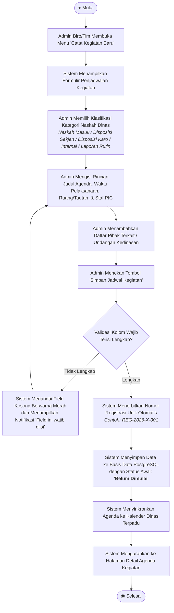
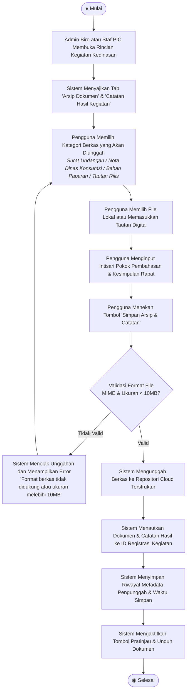
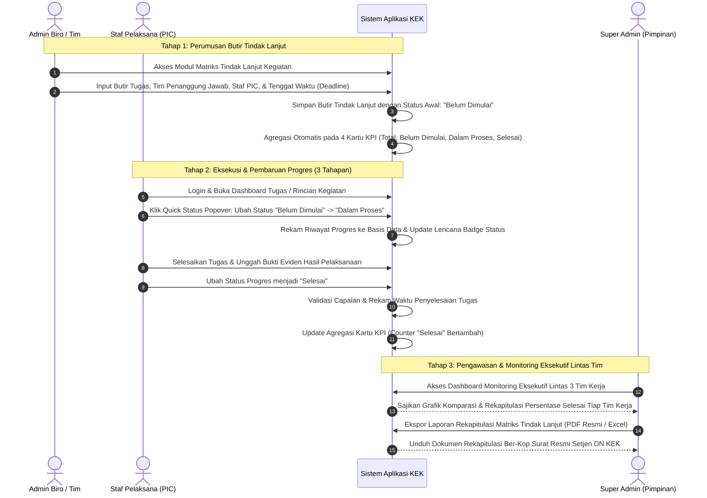

# PERANCANGAN UML ACTIVITY DIAGRAM (SUB-BAB 3.2.2.b)
## Aplikasi Jadwal dan Pengarsipan Kegiatan pada Sekretariat Jenderal Dewan Nasional Kawasan Ekonomi Khusus
**Program Studi Informatika — Fakultas Teknik & Informatika Universitas Bina Sarana Informatika (UBSI) 2026**

Dokumen ini memuat perancangan resmi **UML Activity Diagram (Diagram Alur Aktivitas Bisnis)** dengan format baku laporan akademik (*Swimlane Layout*), memodelkan 3 proses bisnis utama pada Aplikasi Jadwal dan Pengarsipan Kegiatan KEK. Seluruh alur dirancang selaras 100% dengan **UML Use Case Diagram** dan aturan operasional instansi:

> [!IMPORTANT]
> **Prinsip Keselarasan Sistem (Tidak Melenceng dari Use Case):**
> 1. **Tanpa Modul Presensi/Absensi Kehadiran:** Seluruh peserta kegiatan dikelola sebagai *Daftar Pihak Terkait / Undangan Kedinasan* untuk keperluan arsip naskah dinas (tanpa tiket QR, izin/hadir, maupun hitung kuorum).
> 2. **Status Konsisten 3 Tahapan Resmi:** Status kegiatan dan butir tindak lanjut strictly hanya 3 tahapan: `Belum Dimulai`, `Dalam Proses`, dan `Selesai`.
> 3. **Sinkronisasi Peran Aktor:** Selaras dengan 3 aktor pada Use Case Diagram: *Staf Pelaksana (PIC)*, *Admin Biro / Tim*, dan *Super Admin (Pimpinan Setjen)*.

---

## 1. Pemetaan Use Case ke Activity Diagram

| No | Activity Diagram | Use Case Terkait | Aktor Terlibat | Fokus Proses Bisnis |
|:---|:---|:---|:---|:---|
| 1 | **Alur Pencatatan & Penjadwalan Kegiatan Baru** | UC-06, UC-07, UC-02 | Admin Biro/Tim & Sistem | Penginputan kategori naskah dinas, waktu, ruang/lokasi, penunjukan PIC, penerbitan nomor registrasi otomatis, status awal `Belum Dimulai`, sinkronisasi kalender dinas. |
| 2 | **Alur Pengarsipan Berkas Dokumen & Catatan Hasil** | UC-08, UC-09, UC-04 | Admin Biro/Tim, PIC, & Sistem | Unggah berkas dokumen acuan rapat (surat undangan dinas, nota dinas konsumsi, bahan tayang materi, tautan rilis), input catatan hasil rapat, validasi file, dan penyimpanan repositori permanen. |
| 3 | **Alur Monitoring & Pembaruan Status Kegiatan serta Tindak Lanjut** | UC-05, UC-10, UC-11 | Admin Biro/Tim, Staf PIC, Sistem, & Super Admin (Pimpinan) | Perumusan butir tindak lanjut (*action items*), penugasan PIC & deadline, pembaruan status 3 tahapan (`Belum Dimulai` &rarr; `Dalam Proses` &rarr; `Selesai`), agregasi 4 kartu KPI, dan monitoring eksekutif pimpinan. |

---

## 2. Activity Diagram 1: Alur Pencatatan dan Penjadwalan Kegiatan Baru

Memodelkan alur kerja petugas administrasi mencatat agenda kegiatan dinas baru berdasarkan disposisi atau surat naskah masuk hingga terdaftar di kalender kegiatan terpadu.

### A. Visualisasi Mermaid Activity Diagram 1

---

## 3. Activity Diagram 2: Alur Pengarsipan Berkas Dokumen & Catatan Hasil Kegiatan

Memodelkan proses pengarsipan naskah dokumen digital pendukung kegiatan dinas dan pendokumentasian catatan ringkas hasil pembahasan kegiatan.

### A. Visualisasi Mermaid Activity Diagram 2

---

## 4. Activity Diagram 3: Alur Monitoring & Pembaruan Status Kegiatan serta Tindak Lanjut

Memodelkan interaksi terpadu antara 4 swimlane (Admin Biro, Staf PIC, Sistem, dan Pimpinan/Super Admin) dalam mengelola siklus butir tindak lanjut (*action items*) menggunakan strictly 3 tahapan status.

### A. Visualisasi Mermaid Activity Diagram 3 (4 Swimlane)

---

## 5. Ringkasan Kepatuhan Pedoman PKL UBSI 2026

1. **Notasi Baku UML 2.5:** Menggunakan *Initial Node* (lingkaran solid), *Action State* (persegi panjang bersudut tumpul), *Decision Node* (belah ketupat dengan *Guard Condition*), dan *Final Node* (lingkaran ganda).
2. **Kejelasan Swimlane:** Membagi tanggung jawab tugas secara transparan antara aktor manusia dan proses komputasi sistem.
3. **Integritas Konseptual:** Alur aktivitas ini merupakan realisasi langsung dari Use Case Diagram Sub-Bab 3.2.2.a dan tidak ada satu pun alur yang menyimpang dari batasan sistem yang telah ditetapkan.
