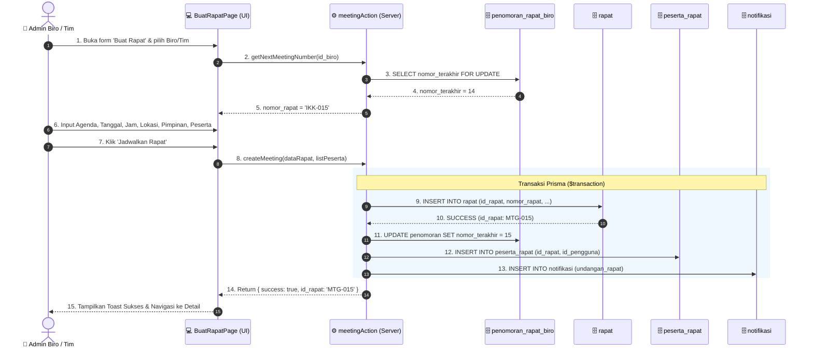
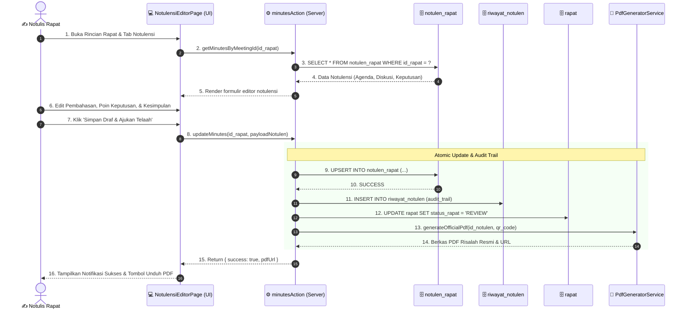
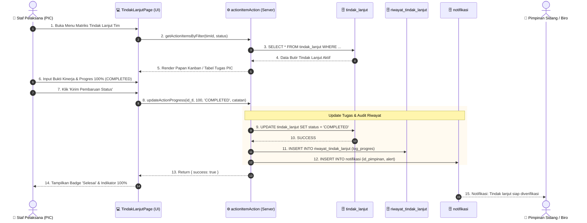

# PERANCANGAN UML SEQUENCE DIAGRAM (SUB-BAB 3.2.2.d)
## Sistem Informasi Log & Notula Rapat (Log_Book_Rapat KEK RI)
**Sekretariat Jenderal Dewan Nasional Kawasan Ekonomi Khusus Republik Indonesia**

Dokumen ini memuat perancangan resmi **UML Sequence Diagram (Diagram Interaksi Kronologis Antar-Objek)** sesuai format baku laporan Skripsi / Tugas Akhir (*Actor → UI/View → Server Action/Controller → Database/Service*), memodelkan 3 proses bisnis utama pada Sistem Informasi Log_Book_Rapat KEK RI.

> [!NOTE]
> **Penempatan pada Laporan PKL (Pedoman PKL UBSI Tahun 2026 Halaman 30 – 31 No. 3):**  
> Diagram ini ditempatkan pada **BAB III PEMBAHASAN &rarr; 3.2. Pembuatan Program &rarr; 3.2.2. Design Program &rarr; d. Sequence Diagram**.

---

## 1. File Diagram & Tautan Akses

* **File Asli Draw.io (Multi-Tab):** [`docs/SEQUENCE_DIAGRAM_Log_Book_Rapat.drawio`](file:///c:/Users/nappz/Documents/Project%20Website/Projek%20Log%20Rapat/docs/SEQUENCE_DIAGRAM_Log_Book_Rapat.drawio)
* **File Publik (Mirror):** [`public/SEQUENCE_DIAGRAM_Log_Book_Rapat.drawio`](file:///c:/Users/nappz/Documents/Project%20Website/Projek%20Log%20Rapat/public/SEQUENCE_DIAGRAM_Log_Book_Rapat.drawio)
* **Tautan Download Langsung:** [http://localhost:3000/SEQUENCE_DIAGRAM_Log_Book_Rapat.drawio](http://localhost:3000/SEQUENCE_DIAGRAM_Log_Book_Rapat.drawio)

> [!TIP]
> **Struktur Multi-Tab Draw.io (`.drawio`):**
> Saat file dibuka di aplikasi **Draw.io (diagrams.net)**, terdapat 3 lembar tab terpisah:
> 1. `1) SD-01: Penjadwalan Rapat` (Admin Biro/Tim → BuatRapatPage → meetingAction → penomoran_rapat_biro → rapat → peserta_rapat → notifikasi)
> 2. `2) SD-02: Notulensi & Risalah` (Notulis Rapat → NotulensiEditorPage → minutesAction → notulen_rapat → riwayat_notulen → rapat → PdfGeneratorService)
> 3. `3) SD-03: Tindak Lanjut & PIC` (Staf Pelaksana PIC → TindakLanjutPage → actionItemAction → tindak_lanjut → riwayat_tindak_lanjut → notifikasi → Pimpinan)

---

## 2. Standar Notasi UML Sequence Diagram

Sesuai dengan standar internasional UML 2.5 dan acuan format penulisan laporan skripsi informatika:

| Elemen Notasi | Simbol Visual | Deskripsi Peran dalam Sistem |
|:---|:---|:---|
| **Actor Lifeline** | Simbol Orang (*Stickman*) di bagian atas garis vertikal putus-putus | Pengguna manusia (Aparatur ASN/Admin/Pimpinan) yang menginisiasi interaksi. |
| **Participant Lifeline** | Kotak persegi panjang dengan garis vertikal putus-putus | Komponen perangkat lunak (*boundary/view*, *controller/server action*, entitas database). |
| **Activation Bar** | Balok persegi panjang putih ramping pada garis vertikal | Menunjukkan periode waktu ketika objek aktif memproses tugas (*execution occurrence*). |
| **Synchronous Message (`―▶`)** | Garis lurus dengan kepala panah padat (*solid arrow*) | Pemanggilan metode/fungsi yang menunggu balasan sebelum melanjutkan eksekusi. |
| **Return Message (`- - ▷`)** | Garis putus-putus dengan kepala panah terbuka (*dashed open arrow*) | Pengembalian nilai (*return value*) atau respons status ke pemanggil. |
| **Asynchronous Message (`- - ▷`)** | Garis putus-putus dengan panah terbuka searah | Pengiriman pesan/notifikasi tanpa memblokir alur kerja pemanggil (*fire-and-forget*). |
| **Note / Transaction Frame** | Kotak catatan kuning (*folded corner note*) | Penjelasan blok logika khusus, seperti transaksi atomik basis data (`$transaction`). |

---

## 3. Rincian Skenario Interaksi Kronologis (Sub-Bab 3.2.2.d)

Berikut rincian 3 skenario Sequence Diagram utama yang dapat langsung dicantumkan ke dalam Bab 3 / Bab 4 laporan tugas akhir:

---

### 1) SD-01: Penjadwalan Rapat Baru & Penomoran Otomatis

Skenario ini memodelkan proses dari inisiasi pembuatan agenda rapat dinas oleh Admin Biro/Tim, pengambilan nomor urut rapat otomatis secara konkurensi aman (*locking*), pengisian data agenda, transaksi atomik penyimpanan ke database (`rapat`, `penomoran_rapat_biro`, `peserta_rapat`, `notifikasi`), hingga umpan balik sukses pada antarmuka pengguna.

#### Tabel Interaksi SD-01:
| No | Pengirim | Penerima | Tipe Pesan | Deskripsi Operasi |
|:---|:---|:---|:---|:---|
| 1 | Admin | `BuatRapatPage` | Sync Call | Membuka formulir pembuatan agenda rapat dinas dan memilih unit kerja biro/tim. |
| 2 | `BuatRapatPage` | `meetingAction` | Sync Call | Mengajukan permohonan nomor registrasi rapat berikutnya untuk biro terkait. |
| 3 | `meetingAction` | `penomoran_rapat_biro` | Sync Call | Melakukan pembacaan nomor terakhir dengan penguncian baris (*pessimistic lock*) untuk mencegah *race condition*. |
| 4 | `penomoran_rapat_biro` | `meetingAction` | Return | Mengembalikan nilai integer nomor urut terakhir (cth: `14`). |
| 5 | `meetingAction` | `BuatRapatPage` | Return | Mengembalikan string nomor rapat terformat (cth: `"IKK-015"`). |
| 6 | Admin | `BuatRapatPage` | User Input | Melengkapi metadata rapat (judul, waktu, lokasi, pimpinan sidang, daftar peserta). |
| 7 | Admin | `BuatRapatPage` | User Action | Menekan tombol submit formulir 'Jadwalkan Rapat'. |
| 8 | `BuatRapatPage` | `meetingAction` | Sync Call | Memanggil fungsi Server Action `createMeeting` dengan membawa payload data rapat. |
| 9 | `meetingAction` | `rapat` | Sync Call | Menjalankan *statement* `INSERT` ke tabel utama `rapat`. |
| 10 | `rapat` | `meetingAction` | Return | Konfirmasi penyimpanan berhasil dengan id rapat baru (`MTG-015`). |
| 11 | `meetingAction` | `penomoran_rapat_biro` | Sync Call | Memperbarui (*increment*) pencatatan nomor urut biro ke nilai `15`. |
| 12 | `meetingAction` | `peserta_rapat` | Sync Call | Mendaftarkan seluruh pegawai yang diundang ke tabel relasi peserta rapat. |
| 13 | `meetingAction` | `notifikasi` | Sync Call | Mengirimkan lonceng pemberitahuan agenda rapat baru kepada para peserta. |
| 14 | `meetingAction` | `BuatRapatPage` | Return | Mengembalikan objek respons `{ success: true, id_rapat: "MTG-015" }`. |
| 15 | `BuatRapatPage` | Admin | UI Feedback | Menampilkan pesan notifikasi pop-up hijau dan membuka rincian rapat. |

---

### 2) SD-02: Penyusunan Risalah & Validasi Notulensi Rapat Resmi

Skenario ini memodelkan proses notulis mencatat dinamika persidangan, pemanggilan draf notulensi, pembaruan konten secara atomik pada tabel `notulen_rapat`, pencatatan audit perubahan pada tabel `riwayat_notulen`, pembaruan status rapat, hingga pembuatan dokumen PDF risalah resmi ber-QR Code.

#### Tabel Interaksi SD-02:
| No | Pengirim | Penerima | Tipe Pesan | Deskripsi Operasi |
|:---|:---|:---|:---|:---|
| 1 | Notulis | `NotulensiEditorPage` | Sync Call | Membuka rincian rapat dan memilih tab pencatatan notulensi. |
| 2 | `NotulensiEditorPage` | `minutesAction` | Sync Call | Mengambil catatan notulensi yang tersimpan sebelumnya. |
| 3 | `minutesAction` | `notulen_rapat` | Sync Call | Mengkueri basis data untuk memeriksa apakah draf sudah pernah dibuat. |
| 4 | `notulen_rapat` | `minutesAction` | Return | Mengembalikan record JSON notulensi (agenda, hasil diskusi, keputusan, kesimpulan). |
| 5 | `minutesAction` | `NotulensiEditorPage` | Return | Merender antarmuka editor teks kaya (*rich text / JSON structure*). |
| 6 | Notulis | `NotulensiEditorPage` | User Input | Mengetik poin pembahasan, hasil kesepakatan, dan arahan pimpinan sidang. |
| 7 | Notulis | `NotulensiEditorPage` | User Action | Menekan tombol 'Simpan Draf & Ajukan Telaah'. |
| 8 | `NotulensiEditorPage` | `minutesAction` | Sync Call | Mengirimkan payload notulensi terbaru ke server. |
| 9 | `minutesAction` | `notulen_rapat` | Sync Call | Melakukan eksekusi `UPSERT` (Insert atau Update) pada tabel `notulen_rapat`. |
| 10 | `notulen_rapat` | `minutesAction` | Return | Konfirmasi record notulensi berhasil disimpan. |
| 11 | `minutesAction` | `riwayat_notulen` | Sync Call | Mencatat riwayat perubahan untuk kebutuhan audit jejak rekam (*audit log*). |
| 12 | `minutesAction` | `rapat` | Sync Call | Memperbarui status rapat menjadi `REVIEW` (menunggu validasi pimpinan). |
| 13 | `minutesAction` | `PdfGeneratorService` | Sync Call | Memanggil service generator dokumen untuk menyusun tata letak PDF resmi ber-QR Code. |
| 14 | `PdfGeneratorService` | `minutesAction` | Return | Mengembalikan status dokumen terkompilasi dan URL unduh berkas. |
| 15 | `minutesAction` | `NotulensiEditorPage` | Return | Mengembalikan respons status sukses beserta tautan PDF. |
| 16 | `NotulensiEditorPage` | Notulis | UI Feedback | Memperbarui antarmuka dengan label 'Tersimpan' dan mengaktifkan tombol unduh risalah. |

---

### 3) SD-03: Monitoring & Pembaruan Status Tindak Lanjut (PIC)

Skenario ini memodelkan proses staf pelaksana (*Person-in-Charge / PIC*) melihat butir penugasan pada papan Kanban/tabel matriks, mengunggah bukti penyelesaian, memperbarui status menjadi `COMPLETED`, mencatat log histori progres pada tabel `riwayat_tindak_lanjut`, serta mengirimkan notifikasi verifikasi kepada pimpinan sidang.

#### Tabel Interaksi SD-03:
| No | Pengirim | Penerima | Tipe Pesan | Deskripsi Operasi |
|:---|:---|:---|:---|:---|
| 1 | Staf PIC | `TindakLanjutPage` | Sync Call | Membuka antarmuka monitoring matriks tindak lanjut penugasan. |
| 2 | `TindakLanjutPage` | `actionItemAction` | Sync Call | Meminta daftar butir tindak lanjut berdasarkan filter tim dan status penugasan. |
| 3 | `actionItemAction` | `tindak_lanjut` | Sync Call | Mengambil data dari tabel `tindak_lanjut` di database Neon PostgreSQL. |
| 4 | `tindak_lanjut` | `actionItemAction` | Return | Mengembalikan daftar penugasan aktif beserta tenggat waktu (*deadline*). |
| 5 | `actionItemAction` | `TindakLanjutPage` | Return | Merender kartu Kanban tugas atau tabel daftar pekerjaan. |
| 6 | Staf PIC | `TindakLanjutPage` | User Input | Memilih tugas, mengunggah tautan laporan bukti pengerjaan, dan memilih status selesai. |
| 7 | Staf PIC | `TindakLanjutPage` | User Action | Menekan tombol 'Kirim Pembaruan Status'. |
| 8 | `TindakLanjutPage` | `actionItemAction` | Sync Call | Mengirimkan parameter ID tugas dan status `COMPLETED`. |
| 9 | `actionItemAction` | `tindak_lanjut` | Sync Call | Menjalankan `UPDATE` kolom `status_tindak_lanjut = 'COMPLETED'` dan `diselesaikan_pada = NOW()`. |
| 10 | `tindak_lanjut` | `actionItemAction` | Return | Basis data mengonfirmasi pembaruan record berhasil. |
| 11 | `actionItemAction` | `riwayat_tindak_lanjut` | Sync Call | Menyimpan catatan log progres baru untuk merekam linimasa penyelesaian tugas. |
| 12 | `actionItemAction` | `notifikasi` | Sync Call | Membuat lonceng notifikasi baru bagi Pimpinan Biro untuk menelaah hasil kerja. |
| 13 | `actionItemAction` | `TindakLanjutPage` | Return | Mengembalikan sinyal sukses ke antarmuka pengguna. |
| 14 | `TindakLanjutPage` | Staf PIC | UI Feedback | Mengubah warna kartu menjadi hijau dengan lencana *Selesai* (*Closed*). |
| 15 | `notifikasi` | Pimpinan | Async Notification | Pimpinan menerima pemberitahuan otomatis bahwa tindak lanjut telah diselesaikan oleh PIC. |

---

## 4. Cara Menggunakan File di Draw.io

1. Buka browser dan kunjungi [https://app.diagrams.net](https://app.diagrams.net).
2. Pilih menu **Open Existing Diagram**.
3. Pilih berkas [`docs/SEQUENCE_DIAGRAM_Log_Book_Rapat.drawio`](file:///c:/Users/nappz/Documents/Project%20Website/Projek%20Log%20Rapat/docs/SEQUENCE_DIAGRAM_Log_Book_Rapat.drawio).
4. Di bagian bawah jendela Draw.io, terdapat 3 tab interaktif:
   - **1) SD-01: Penjadwalan Rapat**
   - **2) SD-02: Notulensi & Risalah**
   - **3) SD-03: Tindak Lanjut & PIC**
5. Untuk menyalin ke laporan Word / LaTeX, gunakan menu **File &rarr; Export as &rarr; PNG / SVG / PDF** dengan resolusi 300 DPI.

---

## 5. Ringkasan Keterpaduan Seluruh Diagram UML Log_Book_Rapat KEK RI

Dengan selesainya perancangan Tahap 5 ini, seluruh rangkaian diagram rekayasa perangkat lunak Log_Book_Rapat KEK RI telah lengkap 100% dan terverifikasi secara matematis:

| No | Tahap Perancangan | Format Notasi | Lokasi File Asli Draw.io | Skor Validasi |
|:---|:---|:---|:---|:---|
| 1 | **ERD (Entity Relationship Diagram)** | Notasi Chen (Tab 1) & Crow's Foot Relasional (Tab 2) | [`docs/ERD_Log_Book_Rapat.drawio`](file:///c:/Users/nappz/Documents/Project%20Website/Projek%20Log%20Rapat/docs/ERD_Log_Book_Rapat.drawio) | **0 error, 0 warning (Skor 0)** |
| 2 | **LRS (Logical Record Structure)** | Relasional 3NF (14 Entitas + FK Mapping Lengkap) | [`docs/LRS_Log_Book_Rapat.drawio`](file:///c:/Users/nappz/Documents/Project%20Website/Projek%20Log%20Rapat/docs/LRS_Log_Book_Rapat.drawio) | **0 error, 0 warning (Skor 0)** |
| 3 | **UML Use Case Diagram** | 3 Aktor, 12 Use Case Terstandar | [`docs/USE_CASE_Log_Book_Rapat.drawio`](file:///c:/Users/nappz/Documents/Project%20Website/Projek%20Log%20Rapat/docs/USE_CASE_Log_Book_Rapat.drawio) | **0 error, 0 warning (Skor 0)** |
| 4 | **UML Class Diagram** | 14 Kelas 3-Kompartemen, 5 Enum, Asosiasi & Multiplisitas | [`docs/CLASS_DIAGRAM_Log_Book_Rapat.drawio`](file:///c:/Users/nappz/Documents/Project%20Website/Projek%20Log%20Rapat/docs/CLASS_DIAGRAM_Log_Book_Rapat.drawio) | **0 error, 0 warning (Skor 0)** |
| 5 | **UML Activity Diagram** | Multi-Tab Swimlane Table: Aktor 1 \| System \| Aktor 2 | [`docs/ACTIVITY_DIAGRAM_Log_Book_Rapat.drawio`](file:///c:/Users/nappz/Documents/Project%20Website/Projek%20Log%20Rapat/docs/ACTIVITY_DIAGRAM_Log_Book_Rapat.drawio) | **0 error, 0 warning (Skor 0)** |
| 6 | **UML Sequence Diagram** | Multi-Tab Lifeline Interaksi Kronologis (SD-01 s.d SD-03) | [`docs/SEQUENCE_DIAGRAM_Log_Book_Rapat.drawio`](file:///c:/Users/nappz/Documents/Project%20Website/Projek%20Log%20Rapat/docs/SEQUENCE_DIAGRAM_Log_Book_Rapat.drawio) | **0 error, 0 warning (Skor 0)** |

---

*Dokumen ini merupakan bagian akhir dari rangkaian dokumentasi resmi rekayasa perangkat lunak Log_Book_Rapat KEK RI ([Tahap 1: ERD](file:///c:/Users/nappz/Documents/Project%20Website/Projek%20Log%20Rapat/docs/1_ERD_DIAGRAM.md) &bull; [Tahap 2: LRS](file:///c:/Users/nappz/Documents/Project%20Website/Projek%20Log%20Rapat/docs/2_LRS_DIAGRAM.md) &bull; [Tahap 3: Use Case](file:///c:/Users/nappz/Documents/Project%20Website/Projek%20Log%20Rapat/docs/3_USE_CASE_DIAGRAM.md) &bull; [Tahap 4: Activity Diagram](file:///c:/Users/nappz/Documents/Project%20Website/Projek%20Log%20Rapat/docs/4_ACTIVITY_DIAGRAM.md) &bull; [Tahap 5: Sequence Diagram](file:///c:/Users/nappz/Documents/Project%20Website/Projek%20Log%20Rapat/docs/5_SEQUENCE_DIAGRAM.md)).*
