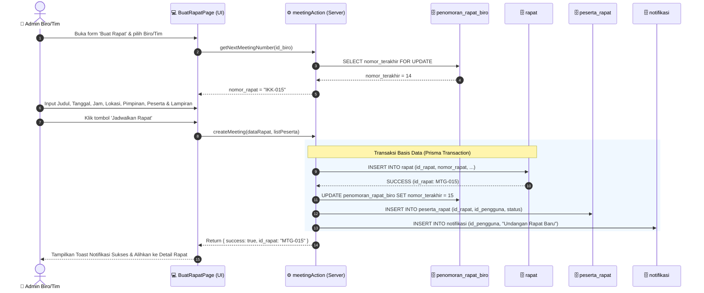
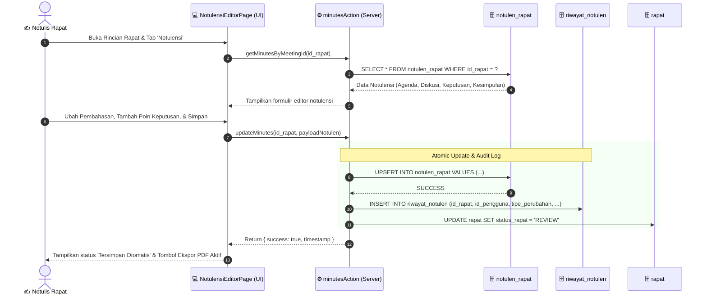
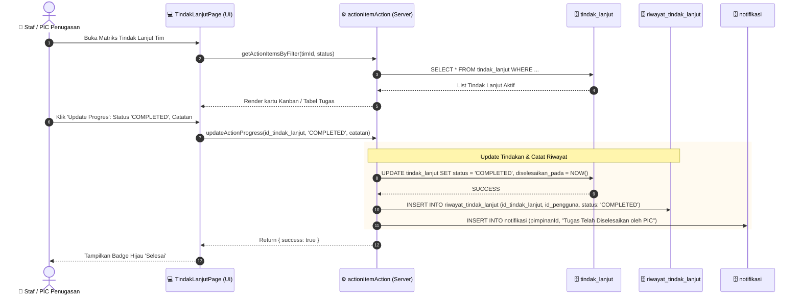

# DOKUMEN PERANCANGAN RESMI: UML DIAGRAM LENGKAP & BASIS DATA RELASIONAL
## Sistem Informasi Log & Risalah Rapat (Log_Book_Rapat KEK RI)
**Sekretariat Jenderal Dewan Nasional Kawasan Ekonomi Khusus Republik Indonesia**

Dokumen ini memuat spesifikasi terstandarisasi **UML Class Diagram, Sequence Diagram, Activity Diagram, dan Basis Data Relasional** dalam **100% Bahasa Indonesia** untuk seluruh **14 entitas aktif** pada basis data **Neon PostgreSQL**. Dokumen ini dirancang sebagai rujukan utama Bab III dan Bab IV Laporan Tugas Akhir / Skripsi serta persiapan sidang sarjana.

> [!NOTE]
> **Dokumen Induk Laporan PKL Resmi (Format Pedoman PKL UBSI 2026 Hal 30 No. 3):**  
> Struktur laporan PKL lengkap yang telah disesuaikan 100% dengan sistematika resmi **BAB I s.d BAB IV (Outline Pembuatan Project Aplikasi)** dapat diakses pada [`docs/LAPORAN_PKL_Log_Book_Rapat_OUTLINE_3.md`](file:///c:/Users/nappz/Documents/Project%20Website/Projek%20Log%20Rapat/docs/LAPORAN_PKL_Log_Book_Rapat_OUTLINE_3.md).

---


## 1. Pemetaan 14 Entitas Basis Data & Relasi 1 to Many (1 : N)

Dalam prinsip pemodelan basis data relasional akademik, ketika Entitas Induk (*Parent*) berelasi **1 to Many** dengan Entitas Anak (*Child*), Primary Key dari tabel Induk disematkan ke dalam tabel Anak sebagai Foreign Key dengan **nama yang konsisten dan mudah dipahami penguji**:

| No | Nama Tabel di Neon DB | Primary Key (PK) | Foreign Key (FK) Masuk | Nama Tabel Induk Asal | Penjelasan Relasi & Kardinalitas |
|:---|:----------------------|:-----------------|:-----------------------|:----------------------|:---------------------------------|
| 1  | **`biro`** | **`id_biro`** | - | - | Entitas Master Unit Kerja Eselon II (1 Biro menaungi banyak Tim, Pegawai, & Rapat). |
| 2  | **`tim_biro`** | **`id_tim`** | **`id_biro`** [FK] | `biro` | **`1 : N`** &mdash; 1 `biro` menaungi banyak `tim_biro` teknis. |
| 3  | **`pengguna`** | **`id_pengguna`** | • **`id_biro`** [FK]<br>• **`id_tim`** [FK, Null] | • `biro`<br>• `tim_biro` | **`1 : N`** &mdash; 1 `biro` menaungi banyak akun pegawai.<br>**`1 : N`** &mdash; 1 `tim_biro` menaungi banyak staf pelaksana. |
| 4  | **`rapat`** | **`id_rapat`** | • **`id_biro`** [FK]<br>• **`id_tim`** [FK, Null]<br>• **`id_pengguna`** [FK]<br>• **`id_notulis`** [FK, Null]<br>• **`id_rapat_sebelumnya`** [FK, Null] | • `biro`<br>• `tim_biro`<br>• `pengguna`<br>• `pengguna`<br>• `rapat` | • **`1 : N`** &mdash; 1 `biro` menyelenggarakan banyak `rapat`.<br>• **`1 : N`** &mdash; 1 `tim_biro` memprakarsai banyak `rapat`.<br>• **`1 : N`** &mdash; 1 `pengguna` memimpin agenda `rapat`.<br>• **`1 : N`** &mdash; 1 `pengguna` mencatat naskah `rapat`.<br>• **`0..1 : N`** &mdash; 1 `rapat` dapat merujuk ke rapat sebelumnya (Unary). |
| 5  | **`penomoran_rapat_biro`** | **`id_penomoran`** | **`id_biro`** [FK, UK] | `biro` | **`1 : 1`** &mdash; 1 `biro` memiliki tepat 1 generator nomor surat urut otomatis. |
| 6  | **`rapat_biro`** | **`(id_rapat, id_biro)`** | • **`id_rapat`** [FK]<br>• **`id_biro`** [FK] | • `rapat`<br>• `biro` | **`M : N`** *(Junction Table)* &mdash; Rapat gabungan yang melibatkan banyak biro sekaligus. |
| 7  | **`peserta_rapat`** | **`id_peserta`** | • **`id_rapat`** [FK]<br>• **`id_pengguna`** [FK] | • `rapat`<br>• `pengguna` | **`1 : N`** &mdash; 1 `rapat` mengundang banyak peserta.<br>**`1 : N`** &mdash; 1 `pengguna` memiliki banyak riwayat kehadiran. |
| 8  | **`lampiran_rapat`** | **`id_lampiran`** | **`id_rapat`** [FK] | `rapat` | **`1 : N`** &mdash; 1 `rapat` dapat memiliki banyak berkas dokumen lampiran. |
| 9  | **`notulen_rapat`** | **`id_notulen`** | **`id_rapat`** [FK, UK] | `rapat` | **`1 : 1`** &mdash; 1 `rapat` menghasilkan tepat 1 risalah / naskah notula resmi. |
| 10 | **`komentar_notulen`** | **`id_komentar`** | • **`id_rapat`** [FK]<br>• **`id_pengguna`** [FK]<br>• **`id_induk`** [FK, Null] | • `rapat`<br>• `pengguna`<br>• `komentar_notulen` | **`1 : N`** &mdash; 1 `rapat` memiliki banyak ulasan review notula.<br>**`1 : N`** &mdash; 1 `pengguna` mengirim banyak komentar.<br>**`0..1 : N`** &mdash; Mendukung balasan bersarang (*thread*). |
| 11 | **`riwayat_notulen`** | **`id_riwayat`** | • **`id_rapat`** [FK]<br>• **`id_pengguna`** [FK] | • `rapat`<br>• `pengguna` | **`1 : N`** &mdash; 1 `rapat` mencatat seluruh audit trail perubahan notula.<br>**`1 : N`** &mdash; 1 `pengguna` dapat melakukan banyak revisi. |
| 12 | **`tindak_lanjut`** | **`id_tindak_lanjut`** | • **`id_rapat`** [FK]<br>• **`id_biro`** [FK]<br>• **`id_tim`** [FK, Null]<br>• **`id_pengguna`** [FK, Null] | • `rapat`<br>• `biro`<br>• `tim_biro`<br>• `pengguna` | • **`1 : N`** &mdash; 1 `rapat` menghasilkan banyak butir arahan.<br>• **`1 : N`** &mdash; 1 `biro` dibebankan banyak tindak lanjut.<br>• **`1 : N`** &mdash; 1 `tim_biro` dibebankan banyak tindak lanjut.<br>• **`1 : N`** &mdash; 1 `pengguna` (PIC) bertanggung jawab atas arahan. |
| 13 | **`riwayat_tindak_lanjut`** | **`id_riwayat`** | • **`id_tindak_lanjut`** [FK]<br>• **`id_pengguna`** [FK, Null] | • `tindak_lanjut`<br>• `pengguna` | **`1 : N`** &mdash; 1 `tindak_lanjut` memiliki rekam jejak progres pekerjaan.<br>**`1 : N`** &mdash; 1 `pengguna` memperbarui log berkala. |
| 14 | **`notifikasi`** | **`id_notifikasi`** | **`id_pengguna`** [FK] | `pengguna` | **`1 : N`** &mdash; 1 `pengguna` menerima banyak pemberitahuan sistem. |

* **Lokasi File Draw.io Resmi (Multi-Diagram Suite):**
  - [`docs/ERD_Log_Book_Rapat.drawio`](file:///c:/Users/nappz/Documents/Project%20Website/Projek%20Log%20Rapat/docs/ERD_Log_Book_Rapat.drawio) (Tab 1: Chen 14 Entitas, Tab 2: Crow's Foot Relasional)
  - [`docs/LRS_Log_Book_Rapat.drawio`](file:///c:/Users/nappz/Documents/Project%20Website/Projek%20Log%20Rapat/docs/LRS_Log_Book_Rapat.drawio) (Logical Record Structure 14 Entitas 3NF)
  - [`docs/USE_CASE_Log_Book_Rapat.drawio`](file:///c:/Users/nappz/Documents/Project%20Website/Projek%20Log%20Rapat/docs/USE_CASE_Log_Book_Rapat.drawio) (3 Aktor, 12 Use Case Terstandar)
  - [`docs/CLASS_DIAGRAM_Log_Book_Rapat.drawio`](file:///c:/Users/nappz/Documents/Project%20Website/Projek%20Log%20Rapat/docs/CLASS_DIAGRAM_Log_Book_Rapat.drawio) (14 Kelas 3-Kompartemen, 5 Enum)
  - [`docs/ACTIVITY_DIAGRAM_Log_Book_Rapat.drawio`](file:///c:/Users/nappz/Documents/Project%20Website/Projek%20Log%20Rapat/docs/ACTIVITY_DIAGRAM_Log_Book_Rapat.drawio) (Tab 1 s.d Tab 3 Swimlane Table)
  - [`docs/SEQUENCE_DIAGRAM_Log_Book_Rapat.drawio`](file:///c:/Users/nappz/Documents/Project%20Website/Projek%20Log%20Rapat/docs/SEQUENCE_DIAGRAM_Log_Book_Rapat.drawio) (SD-01 s.d SD-03 Interaksi Kronologis)


---

## 2. UML Class Diagram Lengkap (Sub-Bab 3.2.2.c)

Berikut adalah spesifikasi diagram kelas UML (*Unified Modeling Language*) yang mencakup seluruh atribut, tipe data, metode operasional, dan derajat relasi:

```mermaid
classDiagram
    direction TB

    %% Enumerations
    class PeranPengguna {
        <<enumeration>>
        SUPER_ADMIN
        ADMIN
        PIMPINAN
        STAFF
    }

    class StatusRapat {
        <<enumeration>>
        DRAFT
        REVIEW
        APPROVED
        FINAL
    }

    class StatusKehadiran {
        <<enumeration>>
        INVITED
        PRESENT
        ABSENT
        EXCUSED
    }

    class StatusTindakLanjut {
        <<enumeration>>
        PENDING
        IN_PROGRESS
        COMPLETED
        OVERDUE
    }


    %% Klaster 1: Organisasi & Akun
    class Biro {
        +String id_biro PK
        +String kode_biro UK
        +String nama_biro
        +String nama_singkat
        +String deskripsi
        +Boolean status_aktif
        +DateTime dibuat_pada
        +DateTime diperbarui_pada
        +hitungBebanKerja()
        +getDaftarPegawai()
        +getStatistikTim()
    }

    class TimBiro {
        +String id_tim PK
        +String id_biro FK
        +String kode_tim
        +String nama_tim
        +String deskripsi_tim
        +Boolean status_aktif
        +DateTime dibuat_pada
        +DateTime diperbarui_pada
        +getDaftarStaf()
        +hitungRapatTim()
    }

    class Pengguna {
        +String id_pengguna PK
        +String id_biro FK
        +String id_tim FK
        +String nama_lengkap
        +String email UK
        +String kata_sandi
        +PeranPengguna peran
        +Boolean status_aktif
        +DateTime dibuat_pada
        +DateTime diperbarui_pada
        +autentikasi()
        +ubahProfil()
        +ambilDaftarTugas()
    }

    %% Klaster 2: Pelaksanaan Rapat
    class PenomoranRapatBiro {
        +String id_penomoran PK
        +String id_biro FK
        +Int nomor_terakhir
        +DateTime dibuat_pada
        +DateTime diperbarui_pada
        +ambilNomorBerikutnya()
    }

    class Rapat {
        +String id_rapat PK
        +String nomor_rapat UK
        +String judul_rapat
        +String id_biro FK
        +String id_tim FK
        +String id_pengguna FK
        +String id_notulis FK
        +String id_rapat_sebelumnya FK
        +DateTime tanggal_rapat
        +String waktu_mulai
        +String waktu_selesai
        +String lokasi_rapat
        +StatusRapat status_rapat
        +String jenis_rapat
        +String pic_rapat
        +String status_progres
        +String kategori_naskah
        +DateTime dibuat_pada
        +DateTime diperbarui_pada
        +buatRapat()
        +perbaruiStatus()
        +tambahPeserta()
        +eksporRisalahPdf()
    }

    class RapatBiro {
        +String id_rapat PK_FK
        +String id_biro PK_FK
    }

    class PesertaRapat {
        +String id_peserta PK
        +String id_rapat FK
        +String id_pengguna FK
        +StatusKehadiran status_kehadiran
        +DateTime dibuat_pada
        +catatKehadiran()
    }

    class LampiranRapat {
        +String id_lampiran PK
        +String id_rapat FK
        +String nama_berkas
        +String url_berkas
        +Int ukuran_berkas
        +String tipe_berkas
        +String kategori
        +DateTime dibuat_pada
        +unggahBerkas()
        +unduhBerkas()
    }

    %% Klaster 3: Notulensi & Risalah
    class NotulenRapat {
        +String id_notulen PK
        +String id_rapat FK
        +Json agenda_pembahasan
        +Json hasil_pembahasan
        +Json poin_keputusan
        +Json kesimpulan
        +DateTime dibuat_pada
        +DateTime diperbarui_pada
        +simpanNotulen()
        +validasiNotulen()
        +cetakDokumenResmi()
    }

    class KomentarNotulen {
        +String id_komentar PK
        +String id_rapat FK
        +String id_pengguna FK
        +String id_induk FK
        +String isi_komentar
        +String seksi
        +Boolean sudah_diselesaikan
        +DateTime dibuat_pada
        +tambahKomentar()
        +balasKomentar()
        +tandaiSelesai()
    }

    class RiwayatNotulen {
        +String id_riwayat PK
        +String id_rapat FK
        +String id_pengguna FK
        +String tipe_perubahan
        +String nama_kolom
        +Json nilai_lama
        +Json nilai_baru
        +String ringkasan_perubahan
        +DateTime dibuat_pada
        +catatAuditTrail()
    }

    %% Klaster 4: Tindak Lanjut
    class TindakLanjut {
        +String id_tindak_lanjut PK
        +String id_rapat FK
        +String id_biro FK
        +String id_tim FK
        +String id_pengguna FK
        +String judul_tindakan
        +String deskripsi_tindakan
        +DateTime tenggat_waktu
        +StatusTindakLanjut status_tindak_lanjut        +DateTime diselesaikan_pada
        +DateTime dibuat_pada
        +DateTime diperbarui_pada
        +perbaruiStatus()
        +perbaruiProgres()
        +tandaiSelesai()
    }

    class RiwayatTindakLanjut {
        +String id_riwayat PK
        +String id_tindak_lanjut FK
        +String id_pengguna FK
        +StatusTindakLanjut status_sebelumnya
        +StatusTindakLanjut status_terbaru
        +String catatan_progres        +DateTime dibuat_pada
        +tambahLogProgres()
    }

    %% Klaster 5: Komunikasi Sistem
    class Notifikasi {
        +String id_notifikasi PK
        +String id_pengguna FK
        +String judul
        +String pesan
        +String tipe
        +String tautan
        +Boolean sudah_dibaca
        +DateTime dibuat_pada
        +kirimNotifikasi()
        +tandaiDibaca()
    }

    %% Hubungan Relasi Antar Kelas
    Biro "1" --> "0..*" TimBiro : id_biro (1:N)
    Biro "1" --> "0..*" Pengguna : id_biro (1:N)
    Biro "1" --> "0..*" Rapat : id_biro (1:N)
    Biro "1" --> "1" PenomoranRapatBiro : id_biro (1:1)
    Biro "1" --> "0..*" TindakLanjut : id_biro (1:N)
    Biro "1" -- "0..*" RapatBiro : id_biro (M:N)

    TimBiro "0..1" --> "0..*" Pengguna : id_tim (1:N)
    TimBiro "0..1" --> "0..*" Rapat : id_tim (1:N)
    TimBiro "0..1" --> "0..*" TindakLanjut : id_tim (1:N)

    Pengguna "1" --> "0..*" Rapat : id_pengguna / id_notulis (1:N)
    Pengguna "1" -- "0..*" PesertaRapat : id_pengguna (1:N)
    Pengguna "0..1" --> "0..*" TindakLanjut : id_pengguna (1:N)
    Pengguna "1" --> "0..*" RiwayatTindakLanjut : id_pengguna (1:N)
    Pengguna "1" --> "0..*" KomentarNotulen : id_pengguna (1:N)
    Pengguna "1" --> "0..*" RiwayatNotulen : id_pengguna (1:N)
    Pengguna "1" --> "0..*" Notifikasi : id_pengguna (1:N)

    Rapat "1" --> "0..1" Rapat : id_rapat_sebelumnya (0..1:N)
    Rapat "1" *-- "0..1" NotulenRapat : id_rapat (1:1)
    Rapat "1" *-- "0..*" TindakLanjut : id_rapat (1:N)
    Rapat "1" *-- "0..*" PesertaRapat : id_rapat (1:N)
    Rapat "1" *-- "0..*" LampiranRapat : id_rapat (1:N)
    Rapat "1" *-- "0..*" KomentarNotulen : id_rapat (1:N)
    Rapat "1" *-- "0..*" RiwayatNotulen : id_rapat (1:N)
    Rapat "1" -- "0..*" RapatBiro : id_rapat (M:N)

    KomentarNotulen "1" --> "0..*" KomentarNotulen : id_induk (0..1:N)
    TindakLanjut "1" *-- "0..*" RiwayatTindakLanjut : id_tindak_lanjut (1:N)
```

---

## 3. UML Sequence Diagram (Sub-Bab 3.2.2.d)

* **File Asli Draw.io (Multi-Tab):** [`docs/SEQUENCE_DIAGRAM_Log_Book_Rapat.drawio`](file:///c:/Users/nappz/Documents/Project%20Website/Projek%20Log%20Rapat/docs/SEQUENCE_DIAGRAM_Log_Book_Rapat.drawio) &bull; [Pratinjau Browser](http://localhost:3000/sequence-diagram-preview.html)
* **Dokumentasi Lengkap:** [`docs/5_SEQUENCE_DIAGRAM.md`](file:///c:/Users/nappz/Documents/Project%20Website/Projek%20Log%20Rapat/docs/5_SEQUENCE_DIAGRAM.md)

Sequence Diagram memodelkan interaksi antar-objek secara kronologis dari waktu ke waktu (*lifeline*) saat suatu fungsionalitas dijalankan.


### 1) SD-01: Penjadwalan Rapat Baru & Penomoran Otomatis
Memodelkan bagaimana Admin Biro menjadwalkan rapat dinas baru, mendapatkan nomor registrasi urut dari database, menyimpan data peserta, dan menyebarkan notifikasi sistem:



---

### 2) SD-02: Penyusunan Risalah & Notulensi Rapat Resmi
Memodelkan Notulis yang mencatat dinamika rapat dinas, menyimpan naskah risalah ke tabel `notulen_rapat`, dan mencatat riwayat versi perubahan ke tabel `riwayat_notulen`:



---

### 3) SD-03: Penugasan & Pembaruan Status Progres Tindak Lanjut
Memodelkan pegawai / PIC yang memperbarui status progres pekerjaan tindak lanjut dan tersimpan pada tabel `riwayat_tindak_lanjut`:



---

## 4. Panduan Menjawab Pertanyaan Dosen Penguji Sidang Skripsi

Berikut adalah kisi-kisi pertanyaan dosen penguji mengenai relasi basis data dan diagram UML beserta cara menjawab yang terbukti efektif dan bernilai akademis tinggi:

### Q1: *"Mengapa jumlah tabel pada perancangan Anda ada 14 entitas dan bukan sekadar 8 tabel?"*
> **Jawaban:**
> *"Bapak/Ibu Penguji, penambahan entitas menjadi 14 tabel dilakukan untuk memenuhi kaidah **Normalisasi Bentuk Normal Ketiga (3NF)** dan kebutuhan fungsional nyata organisasi:*
> 1. *Untuk menghilangkan ketergantungan transitif pada struktur organisasi eselon, kami memisahkan unit kerja ke dalam tabel **`biro`** dan **`tim_biro`**, sehingga penugasan dan rapat dapat difilter secara spesifik per tim kerja.*
> 2. *Untuk menjamin integritas audit kepemerintahan (*good governance*), kami mengimplementasikan tabel audit trail terpisah, yaitu **`riwayat_notulen`** dan **`riwayat_tindak_lanjut`**.*
> 3. *Untuk mendukung kolaborasi review notula sebelum disahkan, disediakan tabel **`komentar_notulen`** dengan relasi hierarkis.*
> 4. *Setiap dokumen pendukung dipisahkan ke dalam **`lampiran_rapat`** agar tidak membebani kapasitas record utama tabel rapat."*

### Q2: *"Bagaimana Anda menerapkan relasi 1 to Many (1 : N) secara konsisten di database?"*
> **Jawaban:**
> *"Seluruh relasi 1 to Many diimplementasikan dengan menempatkan Primary Key dari tabel Induk (*Parent*) menjadi Foreign Key pada tabel Anak (*Child*) dengan nama yang **100% konsisten dan selaras dengan nama tabel asalnya**:*
> - *Primary Key **`id_biro`** pada tabel `biro` disematkan sebagai **`id_biro`** pada tabel `pengguna`, `tim_biro`, dan `rapat`.*
> - *Primary Key **`id_rapat`** pada tabel `rapat` disematkan sebagai **`id_rapat`** pada tabel `peserta_rapat`, `lampiran_rapat`, `tindak_lanjut`, dan `notulen_rapat`.*
> - *Primary Key **`id_pengguna`** pada tabel `pengguna` disematkan sebagai **`id_pengguna`** pada tabel `peserta_rapat`, `tindak_lanjut`, dan `notifikasi`.*
> *Dengan standarisasi ini, saat dibuat UML Class Diagram dan LRS, arah relasi dan kunci tamu terlihat sangat bersih tanpa redundansi atau kebingungan penamaan."*

### Q3: *"Bagaimana Anda menangani relasi Many to Many (M : N) dan Relasi Rekursif (Unary)?"*
> **Jawaban:**
> *"Untuk relasi Many-to-Many antara `rapat` dan `biro` (rapat gabungan lintas instansi), kami memecahnya dengan tabel perantara (*junction table*) bernama **`rapat_biro`** yang memiliki Composite Primary Key `(id_rapat, id_biro)`. Sedangkan relasi Rekursif (Unary) diterapkan pada tabel **`rapat`** melalui kolom Foreign Key opsional **`id_rapat_sebelumnya`** untuk menghubungkan rapat edisi lanjutan ke rapat terdahulu, serta pada tabel **`komentar_notulen`** melalui kolom **`id_induk`** untuk membuat balasan komentar bersarang (*nested thread*)."*
